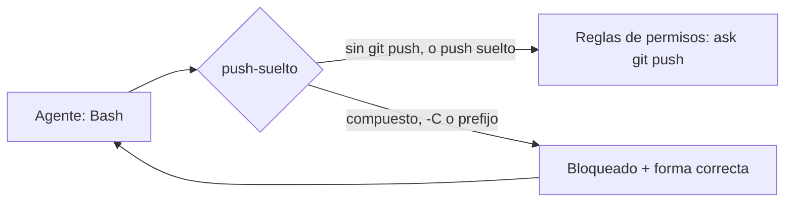

# Un git push solo se ejecuta como comando suelto (`hook` · `push-suelto`)

## 1. Nombre y propósito
Hook `PreToolUse` que rechaza un `git push` compuesto o con opciones antes del subcomando, y le explica al agente la forma correcta. Ver `proposito` en `componente.yaml`.

## 2. Problema que resuelve
Con el sandbox activo, `excludedCommands` (`git push *`) solo saca del sandbox el comando que coincide tal cual. Un `git status ; git push`, un `git -C <ruta> push` o un push dentro de `$(…)` se ejecutan **dentro**, sin acceso a las credenciales, y fallan (H-28). La skill `cerrar-tarea` 0.3.1 ya pedía «push suelto», y en la sesión D de la F5 el agente lo incumplió (H-34). Hubo un diálogo de red evitable y la persona tuvo que subir el commit a mano.

## 3. Objetivo y beneficios esperados
- 0 push fallidos por credenciales en sesiones con sandbox.
- Menos intervenciones humanas, y el agente aprende la forma correcta en el mismo turno.

## 4. Principios y conceptos fundamentales
- Lo que debe cumplirse siempre no se deja a una instrucción (ADR-009): se impone en L3.
- El hook **no aprueba nada**: con exit 0, la regla `ask` de `git push` sigue pidiendo confirmación.
- Exit 2 bloquea la llamada y entrega el stderr al agente (code.claude.com/docs/en/hooks, verificado en F3: «Exit 2 bloquea»).

## 5. Cuándo utilizarlo y cuándo no
- **Usar** en instancias con la plantilla de sandbox (HS-SEC-013) y agentes que hacen push.
- **No hace falta** si los agentes no hacen push (lo hace la persona) o si no se usa sandbox.

## 6. Arquitectura y funcionamiento

Detecta `git … push` y rechaza si:
- el comando contiene `;`, `&&`, `||`, `|`, un salto de línea, `` ` `` o `$(`;
- hay opciones entre `git` y `push`;
- el comando no empieza por `git`.

## 7. Implementación paso a paso
1. `harness components add push-suelto`. Copia el script y añade el bloque `PreToolUse` a `.claude/settings.json`.
2. Subirlo en un PR. Es configuración de agentes (riesgo `medio`), con CODEOWNERS.

## 8. Ejemplo concreto
```
Agente:  git status --short | grep -v '^??' ; git push
Hook:    push-suelto: ejecuta `git push` como un comando suelto… (detectado: compuesto)
Agente:  git push            ← regla ask: la persona confirma; sale del sandbox; funciona
```

## 9. Integración con el resto del harness
- Complementa la plantilla 0.10.0, que tiene `git -C * push *` en `excludedCommands` y en `ask` (C-3).
- Complementa la skill `cerrar-tarea`, que pide el push suelto.
- No sustituye al token de mínimo privilegio ni al ruleset: son la frontera (V11, V9).

## 10. Responsabilidades
| Quién | Responsabilidad |
|---|---|
| Agente | Reformular el comando cuando el hook lo bloquea |
| Persona | Confirmar el push (regla `ask`) |
| Plataforma | Mantener el hook en la configuración base del equipo |

## 11. Seguridad, permisos, límites y modos de fallo
- **Sin permisos ni efectos:** solo lee el evento.
- **Falla en abierto:** con entrada no válida u otra herramienta, exit 0. Es un control de usabilidad L3, no de seguridad.
- **Límites:** no cubre rutas absolutas (`/usr/bin/git push`), alias ni scripts que hagan push por dentro. Tampoco las reglas Bash los cubren (V5).
- **Falso positivo:** un comando que solo menciona `git push` en texto.

## 12. Estrategia de pruebas y verificación
- **17 pruebas unitarias**, entre ellas los dos casos reales de la F5:
  - `git status … ; git push`;
  - `git -C <ruta> push -u origin <rama>`.
- **Integración en F4.6**, en una sesión con sandbox.
- **Por verificar en el laboratorio:** que `tool_input.command` es el campo que recibe el hook con la versión de Claude Code del equipo.

## 13. Métricas de eficacia, calidad, coste y latencia
Ver `metricas` y `coste` en `componente.yaml`.

## 14. Alternativas y compromisos
| Alternativa | Por qué no |
|---|---|
| Solo la instrucción en la skill | Ya existía y no se cumplió (H-34) |
| `deny` de `Bash(*; git push*)` y similares | Las reglas Bash se aplican por partes del comando compuesto; con `deny` no se le explicaría al agente qué hacer, y la lista de formas es abierta |
| Sacar todo `git` del sandbox | Abre la red a cualquier subcomando de git |

## 15. Dependencias, madurez y portabilidad
- `experimental`.
- Claude Code ≥ 2.1.277 (hooks `PreToolUse`); Python 3, solo biblioteca estándar.
- El patrón (validar el comando antes de ejecutarlo) es portable a otros agentes que tengan hooks previos a herramientas.

## 16. Criterios de aceptación para considerarlo implementado
1. Pruebas unitarias en verde y `harness catalog validate` sin errores.
2. F4.6: un push compuesto se bloquea con el motivo, y el agente repite con un push suelto que funciona.

## 17. Referencias y decisiones relacionadas
- H-28, H-34, R-17, ADR-009.
- `standard/adaptadores/claude-code.md` §3.5.
- `fase-3/01-verificacion-fuentes.md` (hooks).
