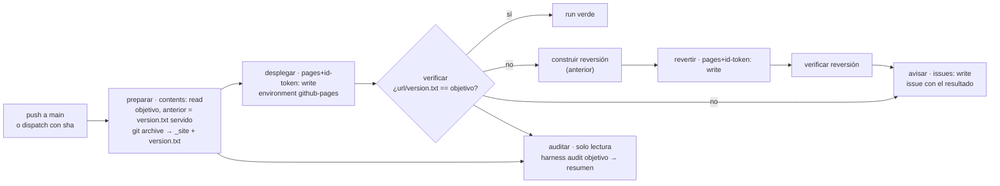

# Despliegue en GitHub Pages con verificación, rollback y auditoría (`workflow` · `despliegue-pages`)

## 1. Nombre y propósito
Workflow de GitHub Actions que despliega en GitHub Pages lo que se fusiona en la rama por defecto. Comprueba que la URL sirve **exactamente** ese SHA y, si no lo hace, vuelve a la versión anterior y abre una issue. Ver `proposito` en `componente.yaml`.

## 2. Problema que resuelve
Vector **V10** del modelo de amenazas: un despliegue no autorizado o imposible de revertir. Un despliegue sin verificar puede dar «verde» aunque el sitio no sirva lo fusionado, y un rollback improvisado puede publicar código que nadie revisó. La F5 exige un despliegue y su rollback **ensayados** con un environment protegido (criterio 5 del plan).

## 3. Objetivo y beneficios esperados
- Run en verde ⇔ la URL sirve el SHA fusionado. Lo comprueba el sistema, no lo afirma un agente.
- Rollback automático y comprobado, sin intervención humana, cuando la verificación falla.
- Rollback manual a un SHA concreto, solo de la historia de la rama por defecto.
- Rastro de auditoría del cambio desplegado (`harness audit`) en cada run.

## 4. Principios y conceptos fundamentales
- **Autoridad en la plataforma** (ADR-009, ADR-010 rev. 2): la rama por defecto solo cambia por PR con checks requeridos, y el environment `github-pages` solo admite esa rama. El workflow repite la comprobación (L4), pero la frontera es L5.
- **Privilegio mínimo por job** (G8): solo `desplegar` y `revertir` tienen `pages: write` + `id-token: write`, y solo ejecutan `actions/deploy-pages`. `avisar` tiene `issues: write`. El resto solo lee.
- **No ejecutar código del commit** al construir: el sitio se extrae con `git archive` y los scripts salen de la rama por defecto (`python3 -I`).
- **Verificación determinista**: `version.txt` en el sitio.
- **El destino del rollback es lo que se servía antes.** Por construcción, es la última versión verificada: cualquier versión que no se verifica se revierte.

## 5. Cuándo utilizarlo y cuándo no
- **Usar** en N1+ para sitios estáticos o documentación en GitHub Pages. Es el entorno del laboratorio (D-054).
- **No usar:**
  - si el sitio necesita compilarse en CI ejecutando código del repositorio: el componente no lo hace (ver §14);
  - para servicios con estado o migraciones: el rollback de Pages solo cambia archivos estáticos;
  - en repos privados del plan Free, donde Pages no está disponible.

## 6. Arquitectura y funcionamiento

- `concurrency` con un grupo fijo y sin cancelar: los despliegues se ejecutan en serie.
- La URL es `vars.HARNESS_PAGES_URL` o, por defecto, `https://<dueño>.github.io/<repo>/`.
- La verificación reintenta hasta 10 minutos (caché de Pages), con parámetro anticaché y `Cache-Control: no-cache`.

## 7. Implementación paso a paso
1. Generar y versionar el sitio en `site/` (o cambiar `ORIGEN_SITIO`). Si se genera con un script, añadir una prueba de que está al día (ejemplo: `scripts/generar_sitio.py` y `tests/test_sitio.py` del ejemplo greenfield).
2. `harness components add despliegue-pages`: copia el workflow, `.harness/despliegue/despliegue.py` y `docs/runbooks/rollback-pages.md`.
3. Declarar `plataforma.entorno_despliegue: github-pages` en el manifiesto. Así `harness platform check` comprueba el environment y `core.runbooks.rollback` (HS-CI-009), el runbook.
4. *Settings → Pages → Source: GitHub Actions*. En *Settings → Environments → github-pages → Deployment branches*, solo la rama por defecto.
5. Ajustar `CLI_REF` al tag de la CLI que use la instancia.
6. Fusionar en un PR. Es de riesgo `alto` porque toca `.github/workflows/` y pasa por la puerta.

## 8. Ejemplo concreto
Resumen de un run sano:
```
preparar     objetivo=3f2a…  anterior=9c1b…  url=https://alacambrapocs.github.io/harness-example-greenfield/
desplegar    ✓  (environment github-pages)
verificar    OK: … sirve 3f2a…
auditar      ## Auditoría de `3f2a…` — Alertas: 0 ✅  (PR #16, T-0007, riesgo bajo, checks, despliegue)
```
Si `verificar` falla: `construir reversión` → `revertir` → `verificar reversión` (9c1b…). El run termina en rojo y se abre la issue «Despliegue fallido de 3f2a… (rollback: success)».

## 9. Integración con el resto del harness
- **HS-CI-007/008:** permisos de nivel superior en lectura, actions fijadas a SHA. Lo comprueban las pruebas del componente con `ci.*`.
- **HS-CI-006:** `platform.deploy-environment` comprueba que el environment existe y tiene política de ramas.
- **HS-CI-009 (propuesto):** el runbook de rollback existe y tiene sus secciones.
- **ADR-016 y D-058:** `harness audit` reconstruye tarea, riesgo y aprobaciones del PR que se despliega.
- **D-069:** el token del agente no tiene Actions ni Deployments, así que un agente no puede lanzar ni revertir despliegues.

## 10. Responsabilidades
| Quién | Responsabilidad |
|---|---|
| Persona que fusiona | Autoriza el despliegue al fusionar, con la puerta si el riesgo es `alto` |
| Responsable de operación | Atiende la issue de despliegue fallido y ejecuta el runbook si el rollback automático no basta |
| Plataforma | Configura Pages y el environment, y revisa `harness platform check` |
| CI | Construye, despliega, verifica, revierte y audita |
| Agente | Nada en este flujo. Puede leer el resultado y proponer un PR de corrección |

## 11. Seguridad, permisos, límites y modos de fallo
- **Permisos:** ver §4. Sin secretos ni credenciales del modelo.
- **Entradas no confiables:** el `sha` del dispatch pasa por `env:`. Se valida como 40 hex y como ancestro de la rama por defecto. El `version.txt` servido solo se usa si es un SHA de esa historia.
- **Construcción:** sin enlaces simbólicos, sin rutas fuera del sitio y sin `version.txt` propio.
- **Límites conocidos:**
  - La verificación comprueba **qué** se sirve, no que el sitio funcione. Para eso están las pruebas antes del merge y el runbook.
  - Si la versión anterior también estaba rota, el rollback la restaura igualmente. La issue lo dice.
  - Un administrador puede saltarse la política de ramas del environment (por verificar en F5.7 si se puede impedir en el plan Free).
- **Por verificar en F5.7:**
  - que dos `deploy-pages` en el mismo run (despliegue y reversión) funcionan con `artifact_name` distinto;
  - que el parámetro anticaché evita la caché de Pages.

## 12. Estrategia de pruebas y verificación
- **Unitarias** (11):
  - `construir` extrae el commit y no el árbol de trabajo;
  - rechaza `version.txt` propio e ignora enlaces;
  - `preparar` exige la rama por defecto y un SHA de su historia;
  - `verificar` reintenta y agota;
  - el aviso cubre los tres casos;
  - permisos por job;
  - reglas `ci.*`;
  - runbook conforme a HS-CI-009.
- **Integración (F5.7)** en `harness-example-greenfield`:
  1. despliegue verificado;
  2. despliegue con verificación forzada a fallar → rollback automático e issue;
  3. rollback manual por SHA;
  4. dispatch desde otra rama → bloqueado.

## 13. Métricas de eficacia, calidad, coste y latencia
Ver `metricas` y `coste` en `componente.yaml`.

## 14. Alternativas y compromisos
| Alternativa | Por qué no (por ahora) |
|---|---|
| Destino del rollback desde la API de deployments (último `success`) | GitHub puede marcar como `inactive` los despliegues anteriores, y un despliegue que luego no se verificó también queda en `success`. `version.txt` servido es más directo y no necesita permisos |
| Rollback con `git revert` y nuevo PR | Correcto para corregir la rama, pero lento para restaurar el servicio. Se recomienda **después** del rollback (runbook, paso 4) |
| Compilar el sitio en CI | Ejecuta código del commit en un job previo al despliegue. Se podrá añadir con un ADR y un job de construcción sin permisos de escritura |
| Branch `gh-pages` | Requiere `contents: write` y mezcla artefactos con el código |

## 15. Dependencias, madurez y portabilidad
- `experimental`. GitHub Actions y Pages (fuente «GitHub Actions»).
- `actions/upload-pages-artifact` v5.0.0 y `actions/deploy-pages` v5.0.0, fijadas a SHA y verificadas en sus releases el 2026-10-28.
- El script usa solo la biblioteca estándar de Python. El patrón (objetivo, anterior, verificación por versión servida) es portable a otras plataformas.

## 16. Criterios de aceptación para considerarlo implementado
1. Pruebas unitarias en verde y `harness catalog validate` sin errores.
2. F5.7: los cuatro escenarios de §12, con evidencia (runs, issue y `curl …/version.txt`).
3. `harness platform check` sin hallazgos de `platform.deploy-environment` en el ejemplo.

## 17. Referencias y decisiones relacionadas
- D-054, D-072, D-073, ADR-009, ADR-010 rev. 2, ADR-013.
- `docs/fase-5/02-modelo-amenazas.md` (V10), `standard/04-archivos/runbooks.dir.md`.
- github.com/actions/deploy-pages (`action.yml`: entrada `artifact_name`, salida `page_url`) y github.com/actions/upload-pages-artifact (`action.yml`: entrada `name`).
- docs.github.com: deployments y statuses (Deployments: read; acceso público sin autenticación).
