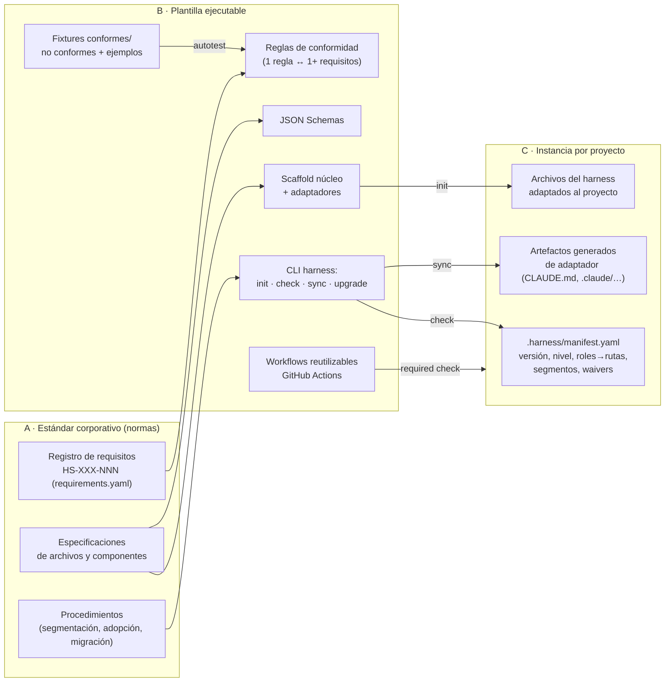

# F0-02 · Arquitectura del estándar

Este documento propone **cómo se organiza el estándar**. No define todavía el contenido normativo de cada archivo de una instancia; eso se hará en las fases 2 a 6. Las estructuras de instancia que aparecen en el §7 son **hipótesis de trabajo**, no la plantilla definitiva.

Contexto que el usuario fijó el 19-10-2026 para la v1:

- Adaptador de agente: **Claude Code**.
- Plataforma: **GitHub y GitHub Actions**.
- Distribución: **un repositorio central dedicado**.
- Perfiles prioritarios: **greenfield** y **brownfield grande**.

El núcleo se diseña de forma que se puedan añadir otros adaptadores (Codex, Copilot, Cursor) sin tocarlo.

## 1. Los tres productos y cómo se relacionan



| Producto | Qué es | Qué no es | Propietario (propuesto) | Versionado |
|---|---|---|---|---|
| **A. Estándar** | Texto normativo con requisitos identificados (DEBE, DEBERÍA o PUEDE) y especificaciones de cada archivo y componente, procedimientos y criterios de conformidad. | No es una guía de buenas prácticas ni una colección de prompts. | Grupo de gobierno del harness (por designar) | SemVer del estándar: `MAJOR.MINOR.PATCH` |
| **B. Plantilla ejecutable** | Implementación de referencia: scaffold, esquemas, CLI de conformidad, generadores de adaptadores, workflows de CI, ejemplos y fixtures. | No es la fuente de las normas: si B y A discrepan, prevalece A y se abre un defecto en B. | Equipo de plataforma o DevEx | Su propio SemVer, que declara qué versiones del estándar soporta (p. ej. `1.x`) |
| **C. Instancia** | El harness concreto de un repositorio: manifiesto, archivos núcleo adaptados, artefactos de adaptador generados y excepciones aprobadas. | No es una copia literal de la plantilla. | Propietario técnico del repositorio | Declara en el manifiesto la versión del estándar y del nivel de conformidad que cumple |

**Regla de trazabilidad** (propuesta): cada requisito de A tiene una clase de verificabilidad. Si es automatizable, debe existir en B al menos una regla con su ID y dos fixtures, uno conforme y otro no conforme. Si no lo es, debe tener un procedimiento de comprobación manual o semiautomática con evidencia. De esta matriz se genera un informe de cobertura.

## 2. Capas: núcleo agnóstico y adaptadores

```
┌──────────────────────────────────────────────────────────────┐
│ Núcleo agnóstico (formato abierto o propio, sin proveedor)   │
│ AGENTS.md · docs/ · .harness/ (manifest, tasks, rules)       │
│ skills en formato Agent Skills (solo campos de la spec)      │
│ contrato de comandos · esquemas · mapa de segmentos          │
├──────────────────────────────────────────────────────────────┤
│ Adaptadores de agente (generados o finos)                    │
│  v1: Claude Code → CLAUDE.md(@AGENTS.md), .claude/settings,  │
│      .claude/agents, .claude/skills, .claude/rules, hooks    │
│  futuro: Codex (.codex/, .agents/skills), Copilot (.github/  │
│      copilot-instructions.md, .github/instructions)…         │
├──────────────────────────────────────────────────────────────┤
│ Adaptadores de plataforma                                    │
│  v1: GitHub → CODEOWNERS, rulesets (como código o checklist),│
│      workflows reutilizables, merge queue, PR template       │
└──────────────────────────────────────────────────────────────┘
```

Principios de la separación:

1. **El núcleo solo usa formatos abiertos o propios del estándar.** AGENTS.md (S-AGENTSMD), Agent Skills con solo los seis campos de la especificación (S-SKILLS), Markdown, YAML/JSON con esquema, y Make o equivalente para comandos.
2. **Un adaptador nunca es fuente de verdad de una norma.** Traduce el núcleo al formato real de la herramienta. Hay dos tipos:
   - **Fino**: un archivo mínimo escrito a mano que solo importa, por ejemplo un `CLAUDE.md` con `@AGENTS.md`.
   - **Generado**: lo produce `harness sync` desde el núcleo, por ejemplo copias en `.claude/skills/` o reglas por ruta. La CI comprueba que no haya deriva.
3. **Todo lo que es seguridad o autorización vive en la capa que lo impone de verdad.** Eso es la configuración de permisos del agente, la plataforma (rulesets, CODEOWNERS) y la CI, no las instrucciones. S-VILA p.20 y S-CC-MEM lo justifican.
4. Cada adaptador declara la versión mínima de la herramienta que exige, porque las capacidades cambian con cada versión. Por ejemplo, la lectura nativa de AGENTS.md llega en Claude Code v2.1.277 y `onFailure: block` en hooks en v2.1.295 (S-CC-SET).

## 3. Estructura del repositorio central (propuesta)

```
harness-standard/                      # repositorio central dedicado
├── README.md                          # qué es, cómo adoptarlo, enlaces
├── CHANGELOG.md                       # cambios de A y B, con notas de migración
├── GOVERNANCE.md                      # roles, proceso de cambio (RFC), aprobación
├── standard/                          # ── PRODUCTO A ──
│   ├── 00-alcance-terminologia.md     # vocabulario normativo (DEBE/DEBERÍA/PUEDE)
│   ├── 01-modelo-conceptual.md        # subsistemas, ciclo de vida, guidance vs enforcement
│   ├── 02-niveles-de-conformidad.md   # N0–N3, waivers
│   ├── 03-estructura-canonica.md      # árbol de instancia y obligatoriedad
│   ├── 04-archivos/                   # 1 ficha por archivo (plantilla §6.1)
│   ├── 05-componentes/                # skills, agentes, hooks, plugins, tools, workflows
│   ├── 06-segmentacion.md             # método de análisis de codebase
│   ├── 07-concurrencia.md
│   ├── 08-verificacion-ci-cd.md
│   ├── 09-seguridad.md
│   ├── 10-contexto-y-coste.md
│   ├── 11-observabilidad-y-metricas.md
│   ├── 12-adopcion-y-migracion.md
│   ├── adaptadores/
│   │   ├── claude-code.md
│   │   └── github.md
│   └── requirements.yaml              # registro máquina de requisitos (fuente de la matriz)
├── adr/                               # decisiones de arquitectura del estándar
├── schemas/                           # JSON Schemas versionados (manifest, task, rule, catalog-entry…)
├── template/                          # ── PRODUCTO B: scaffold ──
│   ├── core/
│   └── adapters/{claude-code,github}/
├── tools/harness-cli/                 # init · check · sync · upgrade · report
├── rules/                             # reglas de conformidad (declarativas + código)
├── ci/                                # workflows reutilizables (workflow_call)
├── catalog/                           # componentes reutilizables (skills, agentes, hooks…)
├── examples/{greenfield,brownfield}/  # instancias completas de ejemplo
└── tests/fixtures/{conforming,non-conforming}/
```

La v1 propone un solo repositorio con dos líneas de versión: la del estándar y la de la plantilla y la CLI. Las alternativas están en el ADR-001.

## 4. Modelo normativo

### 4.1 Requisitos identificados

Los requisitos usan las palabras clave de RFC 2119/8174 traducidas: **DEBE / NO DEBE / DEBERÍA / NO DEBERÍA / PUEDE**. Cada uno tiene una entrada en `standard/requirements.yaml`:

```yaml
# Ejemplo ilustrativo de formato — los requisitos reales se redactan en Fase 1+
- id: HS-INS-001
  titulo: La instancia tiene un archivo de instrucciones raíz en formato AGENTS.md
  nivel: DEBE
  conformidad: [N0, N1, N2, N3]       # niveles a los que aplica
  naturaleza: guidance                # guidance | enforcement
  verificacion: automatica            # automatica | semiautomatica | manual
  reglas: [core.instructions.root-exists]
  fuentes: [S-AGENTSMD, S-OAI-HE#p5, S-CC-MEM#agents-md]
  desde: 0.1.0
  estado: propuesto                   # propuesto | aprobado | deprecado | retirado
  retirada: "Si AGENTS.md deja de ser formato soportado por los adaptadores de la organización"
```

Convenciones:

- **Prefijos por dominio**: `INS` instrucciones, `ARC` arquitectura y segmentación, `STA` estado y tareas, `VER` verificación, `CON` concurrencia, `SEC` seguridad, `CTX` contexto y coste, `CMP` componentes, `CI` integración y despliegue, `OBS` observabilidad, `GOV` gobierno.
- **Naturaleza**: con `naturaleza: enforcement`, el requisito debe estar respaldado por un control determinista. Un requisito `guidance` no puede ser la única protección frente a un riesgo de severidad alta (ver F0-03, ADR-009).
- **Requisitos sin norma propia**: los que no están respaldados por fuentes T1–T3 se marcan como "decisión propia", con su justificación en un ADR. Las cifras del curso (T4) solo pueden servir como valores por defecto ajustables.

### 4.2 Niveles de conformidad (propuesta)

Los niveles se acumulan: cada uno incluye todos los requisitos de los anteriores.

| Nivel | Nombre | Pensado para | Contenido esencial |
|---|---|---|---|
| **N0** | Legible por agentes | Todo repositorio. Primer paso en brownfield. | Manifiesto, AGENTS.md índice, contrato de comandos, mapa de arquitectura, registro de decisiones, línea base de seguridad, CODEOWNERS sobre la configuración de agentes, check de conformidad en CI |
| **N1** | Trabajo verificado | Uso individual de agentes en tareas reales | Tareas con esquema y criterios de aceptación, "hecho" solo con evidencia de CI, jerarquía de verificación por riesgo, checks requeridos, cierre limpio de sesión, permisos del agente con deny-first |
| **N2** | Concurrente | Varias personas y agentes en paralelo | Mapa de segmentos con propietarios y dependencias, worktree y rama por tarea, *leases* de tareas, contratos entre tareas, merge queue, protocolo de conflictos |
| **N3** | Autonomía supervisada | Loops o automatizaciones y revisión por agentes | Clasificación de riesgo por cambio, aprobación humana según riesgo, agentes revisores como señal informativa, auditoría, métricas y evals del harness, límites de presupuesto |

Las **excepciones (waivers)** se declaran en el manifiesto. Cada una indica el requisito, el motivo, quién la aprueba y la fecha de caducidad. La CLI avisa cuando una excepción está a punto de caducar y falla cuando ya ha caducado.

## 5. Roles de archivo y manifiesto

Los validadores del curso fallan porque buscan nombres fijos y títulos en inglés (F0-01 §6). La propuesta es que el estándar defina **roles** y que el manifiesto de la instancia diga qué ruta cumple cada uno. El estándar fija una ruta por defecto para cada rol, y desviarse de ella requiere declararlo.

```yaml
# .harness/manifest.yaml — ilustrativo, el esquema definitivo se fija en Fase 1
standard: { version: "1.0.0", level: N1 }
project: { name: payments-api, owner: "@org/payments-leads", kind: service }
adapters:
  agents: [{ id: claude-code, min_version: "2.1.277" }]
  platform: { id: github }
commands:            # contrato de comandos (rol → invocación real)
  setup: "make setup"
  check: "make check"          # lint + tipos + tests rápidos
  test:  "make test"
  e2e:   "make e2e"
roles:               # solo si difiere del valor por defecto del estándar
  architecture_map: docs/architecture/ARCHITECTURE.md
segments: .harness/segments.yaml
waivers:
  - requirement: HS-VER-004
    reason: "Sin entorno E2E hasta Q1"
    approved_by: "@jdoe"
    expires: 2027-01-31
```

## 6. Plantillas de especificación

### 6.1 Ficha de archivo

Una por archivo o rol del núcleo y del adaptador, en `standard/04-archivos/`. Recoge todos los campos que pidió el usuario más los que exige la trazabilidad.

```yaml
rol: <identificador estable del rol, p.ej. instructions.root>
ruta_por_defecto: AGENTS.md
obligatoriedad: obligatorio | condicional(<condición>) | opcional
nivel_minimo: N0
capa: nucleo | adaptador:<id>
proposito: …
contenido_requerido: [secciones/campos con anclas o claves de esquema]
contenido_excluido: […]            # qué NO debe contener y dónde va en su lugar
consumidores: [agentes, humanos, CI, CLI]
dependencias: [roles referenciados]
propietario: <rol organizativo, p.ej. tech-lead del repo>
formato: markdown | yaml+schema:<id> | json+schema:<id>
ejemplo_canonico: template/core/…
validaciones: [ids de reglas]
criterios_aceptacion: […]
ciclo_de_vida: { creacion: …, actualizacion: …, revision: …, retirada: … }
politica_evolucion: "cambios MAJOR si cambia el rol o campos requeridos"
requisitos: [HS-…]
fuentes: […]
```

### 6.2 Ficha de componente

Para skills, agentes, hooks, plugins, herramientas y workflows se aplica la plantilla de 17 puntos de las instrucciones del proyecto. Además, cada componente del catálogo tiene un `catalog-entry.yaml` legible por máquina con estos campos: id, tipo, versión, estado (`experimental | estable | deprecado | retirado`), propietario, contrato de entrada y salida, permisos necesarios, adaptadores compatibles, pruebas o evals, métricas, coste estimado de contexto y condición de retirada. Se especifica en la Fase 3.

## 7. Hipótesis de trabajo: estructura de una instancia

Este árbol **no es la plantilla definitiva**. Su único fin es que se puedan discutir las decisiones de F0-03. Leyenda: [O] obligatorio · [C] condicional · [R] recomendado · [G] generado por la CLI.

```
<repo>/
├── AGENTS.md                         [O] índice: propósito, comandos, restricciones duras, mapa de docs
├── CLAUDE.md                         [C:claude-code] adaptador fino: "@AGENTS.md" + lo exclusivo de Claude
├── .harness/
│   ├── manifest.yaml                 [O] versión, nivel, roles, comandos, waivers
│   ├── segments.yaml                 [C:N2 o repo grande] mapa de segmentos (método F4)
│   ├── rules/                        [C] reglas de arquitectura del proyecto (qué/por qué/remedio/retirada)
│   └── tasks/                        [C:N1] un archivo por tarea con esquema (estado, aceptación, evidencia)
├── docs/
│   ├── architecture/ARCHITECTURE.md  [O] mapa de dominios, capas y límites
│   ├── decisions/NNNN-*.md           [O] ADR del proyecto
│   ├── plans/{active,completed}/     [C:N1] planes de ejecución
│   ├── security/SECURITY.md          [O] amenazas, secretos, acciones que requieren aprobación
│   ├── quality/QUALITY.md            [R] estado de calidad por segmento
│   ├── runbooks/                     [C:despliega] despliegue, rollback, incidentes
│   └── references/                   [R] referencias para el modelo (p.ej. *-llms.txt)
├── <segmento>/AGENTS.md              [C] instrucciones locales del segmento
├── .agents/skills/<skill>/SKILL.md   [R] skills núcleo (solo campos de la especificación)
├── .claude/                          [C:claude-code]
│   ├── settings.json                 [O si claude-code] permisos deny-first, hooks, sandbox
│   ├── agents/*.md                   [R] subagentes (p.ej. verificador)
│   ├── skills/                       [G] sincronizado desde .agents/skills
│   └── rules/*.md                    [G|R] reglas por ruta generadas desde segmentos o reglas
├── .github/
│   ├── CODEOWNERS                    [O] incluye rutas de configuración de agentes
│   ├── pull_request_template.md      [O] enlaza tarea, riesgo y evidencia
│   └── workflows/harness.yml         [O] llama al workflow reutilizable de conformidad
└── Makefile | justfile | package.json scripts   [O] implementación del contrato de comandos
```

## 8. Herramienta de conformidad (diseño de alto nivel)

```
manifest.yaml ─┐
repo tree ─────┼─► Loader (roles→rutas) ─► Motor de reglas ─► Resultados ─► Informe (texto/JSON/SARIF)
schemas/ ──────┤                         (schema · estructura · │              │
rules/ ────────┘                          grafo · comando · git)│              └► exit code por severidad
                                                                └► waivers vigentes / caducados
```

- **Tipos de regla**:
  - **schema**: valida YAML, JSON o frontmatter contra JSON Schema.
  - **estructura**: existencia, tamaño y anclas obligatorias.
  - **referencias**: enlaces e `@imports` resolubles, porque un `@import` roto falla en silencio (S-VILA p.20).
  - **deriva**: los artefactos de adaptador coinciden con lo que generaría `harness sync`.
  - **gobierno**: CODEOWNERS cubre las rutas sensibles.
  - **ejecución**: `setup` y `check` terminan con código 0 en un runner limpio.
- **Severidad**: `error` (bloquea), `warning` (no bloquea, se informa) e `info`. Por defecto, la severidad depende del nivel declarado.
- **Salidas**: JSON estable para la CI y SARIF para anotar el PR en GitHub. Se propone SARIF porque GitHub code scanning lo acepta; queda por verificar en la Fase 7.
- **Autotest**: la plantilla y cada ejemplo superan `harness check` en la CI del repositorio central. Cada regla tiene sus fixtures.

## 9. Criterios de aceptación de esta arquitectura

1. Está aprobada la separación A/B/C y la regla "A prevalece sobre B" (ADR-001).
2. Está aprobado el modelo de requisitos con ID, naturaleza y verificabilidad, y los niveles N0–N3 (ADR-002, ADR-007).
3. Están aprobados el núcleo y los adaptadores, con AGENTS.md como fuente única (ADR-003, ADR-012).
4. Está aprobado el manifiesto con descubrimiento por roles (ADR-004).
5. Existe una matriz de trazabilidad vacía pero funcional (`requirements.yaml` → reglas → fixtures) que se puede rellenar desde la Fase 1.
