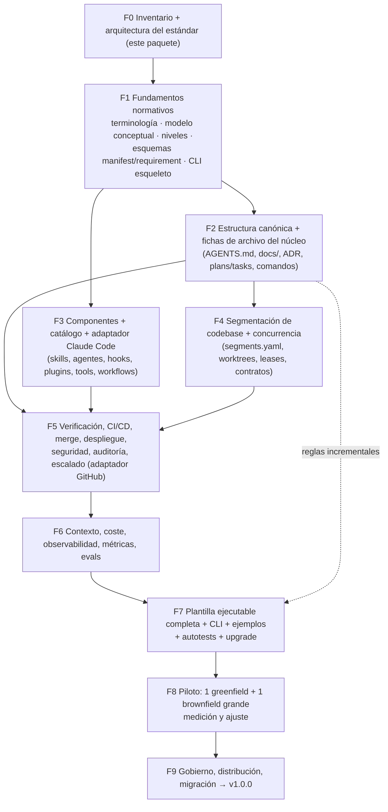

# F0-04 · Método de elaboración y plan de fases

## 1. Principios del método

1. **Norma y validación se publican juntas.** Si un requisito es automatizable, su regla y sus fixtures (uno conforme y otro no conforme) entran en el mismo cambio. Lo que no se pueda automatizar lleva un procedimiento de comprobación. Ninguna fase se cierra con requisitos automatizables sin su regla.
2. **Esqueleto ejecutable desde la Fase 1.** La CLI empieza con una sola regla, la validación del manifiesto, y crece fase a fase. No se deja la plantilla para el final.
3. **Primero la fuente.** Antes de normar un formato de herramienta se verifica en la documentación oficial (T1) y se anota la fecha de verificación. Las fuentes T4 (curso) aportan patrones, no umbrales.
4. **Cada decisión es un ADR** con estado propuesto, aprobado, reemplazado o retirado. Solo el usuario o el grupo de gobierno puede pasar un ADR a "aprobado".
5. **Validación con casos reales.** Cada fase se prueba sobre los ejemplos (greenfield y brownfield). La Fase 8 lo hace sobre repositorios reales del equipo.
6. **Presupuesto de complejidad.** Cada requisito y componente nuevo declara su coste y su condición de retirada (ADR-015). Se prefiere el mecanismo más pequeño que cubra el riesgo.

## 2. Fases y dependencias

Las fases F2 y F3 pueden avanzar en paralelo una vez aprobada F1. F4 necesita las fichas de F2. F5 integra todo lo anterior. F7 recibe las reglas de cada fase de forma incremental; como fase propia, solo cierra el empaquetado, `upgrade` y los ejemplos completos.

## 3. Detalle por fase

Los puntos del encargo de las tablas siguientes se refieren a los diez puntos de la petición del usuario.

### F1 · Fundamentos normativos

| | |
|---|---|
| **Entradas** | ADR-001 a 007, 009 y 013 aprobados o ajustados |
| **Entregables** | `00-alcance-terminologia.md`, `01-modelo-conceptual.md`, `02-niveles-de-conformidad.md`; esquemas `manifest.schema.json` y `requirement.schema.json`; `requirements.yaml` con los primeros requisitos N0; CLI esqueleto (`harness check` valida el manifiesto); estructura del repositorio central creada |
| **Fuentes por leer** | Posts de ingeniería de Anthropic citados en el corpus (*effective harnesses*, *harness design*); RFC 2119/8174 |
| **Criterios de aceptación** | (1) El repositorio central existe con su CI. (2) `harness check` pasa sobre un fixture conforme y falla con un mensaje de remedio sobre uno no conforme. (3) Cada requisito N0 tiene ID, naturaleza, verificabilidad y fuente. (4) La matriz de trazabilidad se genera. |

### F2 · Estructura canónica y fichas del núcleo

| | |
|---|---|
| **Puntos del encargo** | 1, 2, 3 y 4 |
| **Entregables** | `03-estructura-canonica.md` con el árbol de obligatoriedad definitivo para N0-N1; una ficha (F0-02 §6.1) por rol: instrucciones raíz y locales, mapa de arquitectura, ADR, planes y tareas, seguridad, calidad, contrato de comandos, CODEOWNERS y plantilla de PR; esquema de tarea; reglas de jerarquía y no duplicación de instrucciones; presupuesto de tamaño |
| **Fuentes por leer** | Cookbook de planes de ejecución de OpenAI (S-OAI-HE p.6); estudio de ETH Zurich sobre AGENTS.md; matklad ARCHITECTURE.md |
| **Criterios de aceptación** | Todas las fichas completas y sin campos vacíos sin justificar. El ejemplo greenfield cumple N1 con `harness check`. Hay una regla de duplicación entre `AGENTS.md` y `CLAUDE.md`. |

### F3 · Componentes, catálogo y adaptador de Claude Code

| | |
|---|---|
| **Puntos del encargo** | 5 y la parte de adaptadores del 4 |
| **Entregables** | Contrato por tipo de componente (skill, agente, hook, plugin, herramienta o MCP, workflow); esquema `catalog-entry`; ciclo de vida (experimental → estable → deprecado → retirado); `adaptadores/claude-code.md` con el mapeo núcleo → archivos reales, versión mínima y `settings.json` base deny-first; `harness sync` para skills y reglas por ruta; 2-3 componentes semilla, por ejemplo un subagente verificador, un hook de protección de rutas sensibles y una skill de cierre de tarea |
| **Fuentes por leer** | S-SKILLS, S-CC-SET (hooks, sub-agents, plugins), S-MCP security best practices |
| **Criterios de aceptación** | Cada componente semilla tiene ficha de 17 puntos, `catalog-entry` válido, pruebas y condición de retirada. `skills-ref validate` pasa. No hay deriva tras `harness sync`. |

### F4 · Segmentación y concurrencia

| | |
|---|---|
| **Puntos del encargo** | 6 y 7 |
| **Entregables** | Procedimiento de análisis de codebase: inventario, grafo de dependencias, propiedad, *hotspots* de cambio, límites, contratos y clasificación de paralelización; esquema de `segments.yaml`; generadores y validadores derivados (CODEOWNERS, AGENTS.md locales, reglas de dependencias); protocolo tarea → rama → worktree, *leases*, contratos entre tareas, integración, resolución de conflictos y recuperación tras una interrupción |
| **Fuentes por leer** | S-GIT; Claude Code worktrees y agent teams; S-VILA p.22-23 |
| **Criterios de aceptación** | El método aplicado al ejemplo brownfield produce un `segments.yaml` válido. Una simulación de 3 tareas concurrentes no tiene conflictos en los archivos de estado y detecta un conflicto semántico provocado a propósito. |

### F5 · Verificación, CI/CD, seguridad y escalado

| | |
|---|---|
| **Puntos del encargo** | 8 |
| **Entregables** | Jerarquía de verificación por clase de riesgo; workflows reutilizables de GitHub (conformidad, checks, agente revisor informativo, ejecución headless con `--bare`); especificación de rulesets y merge queue; despliegue con environments protegidos y rollback; modelo de amenazas (prompt injection, secretos, MCP, configuración de agentes); auditoría; matriz de escalado a humanos |
| **Fuentes por leer** | S-GH (rulesets, merge queue, permisos, OIDC, environments); `anthropics/claude-code-action`; GitHub Agentic Workflows (citado en el corpus) |
| **Criterios de aceptación** | Prueba adversarial del ADR-009 superada. Ningún job con credenciales del modelo tiene permiso de escritura. Las reglas de ruleset se pueden comprobar. |

### F6 · Contexto, coste, observabilidad y evaluación

| | |
|---|---|
| **Puntos del encargo** | 9 y la evaluación medible |
| **Entregables** | Política de divulgación progresiva y presupuestos de contexto; estado persistente frente a conocimiento estable; métricas: tiempo hasta integración, tasa de reintentos, intervenciones humanas por tarea, coste por tarea, defectos escapados, conflictos; fuentes de telemetría disponibles; protocolo de evals del harness (tareas de referencia, repeticiones, ablación) |
| **Criterios de aceptación** | Las métricas tienen definición operativa y fuente de datos verificada. El protocolo de ablación se ejecuta en seco sobre un ejemplo. |

### F7 · Plantilla ejecutable completa

| | |
|---|---|
| **Puntos del encargo** | Plantilla, ejemplos, validaciones y parte del 10 |
| **Entregables** | `harness init`, `check`, `sync`, `upgrade` y `report`; ejemplos completos greenfield y brownfield; salida SARIF y JSON; decisión del ADR-008 (lenguaje y Copier) |
| **Criterios de aceptación** | La plantilla y los ejemplos pasan su propia validación en CI. Se demuestra una actualización 0.x → 0.y sin perder cambios locales. Cobertura del 100 % de los requisitos automatizables. |

### F8 · Piloto

| | |
|---|---|
| **Entregables** | Instancias en un greenfield (objetivo N2) y un brownfield grande (objetivo N1); línea base y medición antes y después; informe de fricciones; ajustes al estándar |
| **Criterios de aceptación** | Métricas de F6 recogidas al menos durante 2 semanas por repositorio. Lista de cambios al estándar priorizada. |

### F9 · Gobierno y v1.0

| | |
|---|---|
| **Puntos del encargo** | 10 |
| **Entregables** | `GOVERNANCE.md` (roles, proceso RFC, cadencia de revisión); política de versiones y deprecación; guía de migración; plan de implantación por oleadas; condiciones de retirada revisadas |
| **Criterios de aceptación** | v1.0.0 publicada. Al menos 2 repositorios en conformidad declarada. Los responsables de mantenimiento están designados. |

## 4. Forma de trabajo por sesión

- Al inicio de cada fase: se cargan `REGISTRO.md` y los documentos de la fase anterior. No se recarga todo el corpus.
- Al cierre de cada fase: se actualizan `REGISTRO.md` (decisiones, cuestiones abiertas, riesgos y próximos pasos) y los documentos de la fase, en el Project y en la carpeta local.
- Las verificaciones de documentación oficial se registran con fecha en el documento de la fase. Si una capacidad cambia, se abre una cuestión en el registro.
