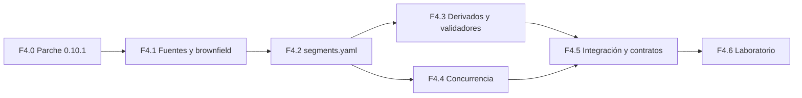

# Fase 4 · Plan

## Objetivo

Que **varias personas y agentes trabajen a la vez** en una codebase grande sin pisarse y sin conflictos evitables. Se cubren los puntos 6 y 7 del encargo (objetivos 4 y 6 del proyecto):
1. Un **mapa de segmentos** verificable dice qué partes hay, de quién son, qué pueden usar y qué se puede paralelizar (ADR-014).
2. Un **protocolo de concurrencia** asigna a cada tarea su rama y su worktree, con una reserva temporal (*lease*), con detección de solapamientos y con integración ordenada (ADR-011).

Criterios del plan de fases (F0-04):
- el método aplicado a un ejemplo brownfield produce un `segments.yaml` válido;
- una simulación de **3 tareas concurrentes** no tiene conflictos en los archivos de estado y **detecta un conflicto semántico** provocado a propósito.

## Lo que ya existe y lo que falta

| Ya existe | Falta |
|---|---|
| Rol `segments.map` (`.harness/segments.yaml`) y campo `segments` en el manifiesto, sin esquema | Esquema, método de análisis, generador y validadores |
| `AGENTS.md` de segmento (HS-INS-011) y presupuesto de la cadena | Que se deriven del mapa y se comprueben contra él |
| Campos `segments`, `depends_on` y `lease` en el esquema de tareas, sin uso | Reclamar y liberar tareas, caducidad, detección de solapamientos |
| Riesgo calculado por rutas (D-058) | Riesgo y política de paralelización por segmento |
| `INDEX.md` de tareas generado y versionado | **Es un punto de conflicto seguro:** todas las tareas lo tocan. Hay que resolverlo (ver F4.4) |

## Incrementos

| # | Entregable | Contenido | Depende de |
|---|---|---|---|
| **F4.0** | Parche 0.10.1 | H-33 (skill: `ready → done`). H-34 (hook `PreToolUse` que rechaza `git push` compuesto). H-35 (`pr risk` incluye el `risk:` de las tareas que el PR referencia). H-36 (`concurrency` en el workflow de tareas) | — |
| **F4.1** | Fuentes y caso brownfield | Verificación en fuentes oficiales: `git worktree` (S-GIT); Claude Code: `--worktree`, aislamiento de subagentes por worktree y *agent teams*; merge queue en el plan Free (G5); `.gitattributes` y *merge drivers*. Elegir y preparar el **ejemplo brownfield** (decisión 1) | — |
| **F4.2** | Mapa de segmentos (ADR-014) | Esquema de `segments.yaml`: rutas, propósito, propietario, dependencias permitidas, contrato público, comandos propios, clase de riesgo y política de paralelización. **Método de análisis** (inventario, grafo de dependencias, propiedad, *hotspots* por historial de git) y `harness segments propose`: propone, una persona revisa y versiona | F4.1 |
| **F4.3** | Derivados y validadores | `segments check`: cobertura de rutas, CODEOWNERS coherente con los propietarios, `AGENTS.md` de segmento existentes y dependencias reales (imports en Python) contra las permitidas. `pr risk` usa el riesgo del segmento. Requisitos `HS-ARC-*` / `HS-CON-*` candidatos | F4.2 |
| **F4.4** | Protocolo de concurrencia (ADR-011) | Tarea → rama → worktree. *Lease* en el archivo de tarea con caducidad (`harness tasks claim/release`). Check `tasks.overlap`: tareas activas que tocan el mismo segmento sin contrato se serializan. Política por segmento: libre, con contrato o serializada. Sin conflictos en archivos de estado: `INDEX.md` generado en la CI o con *merge driver* (decisión 3). Recuperación tras interrupción (lease caducado, worktree huérfano) | F4.2 |
| **F4.5** | Integración y conflictos semánticos | Contratos entre tareas (interfaz declarada y pruebas de contrato). Integración: actualizar contra la base y, si está disponible, merge queue con `merge_group` (ya exigido, HS-CI-008). Qué se paraleliza y qué no, en una matriz de decisión | F4.3, F4.4 |
| **F4.6** | Prueba en el laboratorio | Método sobre el brownfield → `segments.yaml` válido. Simulación de **3 tareas concurrentes** (agentes en worktrees y una persona): sin conflictos en archivos de estado; un **conflicto semántico** provocado se detecta antes del merge. Medición de conflictos y retrabajo | Todos |

F4.3 y F4.4 pueden avanzar en paralelo.

## Decisiones que se tomarán (una a una)

| Momento | Decisión | Propuesta provisional |
|---|---|---|
| F4.1 | **1. Ejemplo brownfield** | Un repositorio público mediano en Python con módulos claros, copiado a `ALacambraPoCs` (candidato: `httpie/cli`, licencia BSD; **por verificar**). Alternativas: uno sintético, controlado pero poco realista, o esperar a los repos del piloto (Q-09), que bloquea la fase |
| F4.2 | **2. ADR-014** (mapa como artefacto pivote) | Aprobar con un alcance: el mapa lo **propone** la CLI y lo **aprueba** una persona. Los derivados se **validan** y no se regeneran a ciegas |
| F4.4 | **3. Archivos de estado compartidos** (`INDEX.md`) | Dejar de versionar el índice, o regenerarlo con un *merge driver*. La CI lo valida igual |
| F4.4 | **4. ADR-011** (lease) | Lease en el archivo de tarea (fuente de verdad única, ADR-005) con caducidad. La issue (X-01) solo refleja |
| F4.5 | **5. Merge queue** | Usarla si el plan lo permite. Si no, «actualizar con la base» obligatorio en la ruleset |

## Criterios de aceptación de la fase

1. `segments.yaml` del brownfield válido, con todas las rutas cubiertas o excluidas explícitamente.
2. `segments check` detecta:
   - una dependencia prohibida provocada;
   - un CODEOWNERS incoherente con el mapa.
3. `tasks.overlap` impide que dos tareas activas tomen el mismo segmento serializado.
4. Simulación de 3 tareas concurrentes **sin conflictos de merge en archivos de estado**, y **detección del conflicto semántico** provocado antes del merge.
5. Recuperación documentada y probada de un lease caducado y de un worktree abandonado.

## Supuestos y riesgos

- **Q-09:** sin repositorios reales, el brownfield es un sustituto. Su validez se confirma en F8.
- **R-10:** con una persona, la «persona concurrente» de la simulación es la misma que supervisa. Los agentes concurrentes sí son independientes.
- El análisis de dependencias se hace primero para **Python**, el lenguaje del ejemplo. Otros lenguajes, por adaptadores (F7).
- **Coste:** 3 agentes en paralelo multiplican el consumo de tokens. Se mide y se lleva a la F6.
