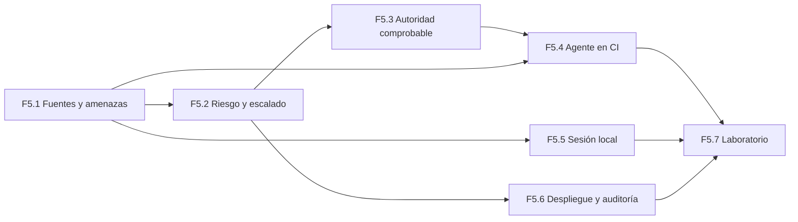

# Fase 5 · Plan

## Objetivo

Que la **autoridad** del harness esté en mecanismos de plataforma comprobables (rulesets, checks requeridos, environments, tokens de mínimo privilegio, sandbox, *managed settings*) y no en instrucciones ni en reglas Bash, que la F3 ha demostrado que son **reducción de riesgo, no frontera** (R-15, R-16, R-17).

La fase define cómo verifica, integra y despliega un equipo según el **riesgo** del cambio, cuándo escala a una persona y cómo se audita. También dónde puede trabajar un agente en CI sin que un PR malicioso pueda usarlo.

Encargo (fase-0, F5): jerarquía de verificación por clase de riesgo; workflows reutilizables de GitHub (conformidad, checks, agente revisor informativo, ejecución headless con `--bare`); rulesets y merge queue; despliegue con environments protegidos y rollback; modelo de amenazas; auditoría; matriz de escalado.

## Incrementos

| # | Entregable | Contenido | Depende de |
|---|---|---|---|
| **F5.1** ✅ (D-057; `01-verificacion-fuentes.md`, `02-modelo-amenazas.md`) | Fuentes y modelo de amenazas | Verificación en documentación oficial: rulesets (checks requeridos, code owners, aprobación del último push, merge queue), environments, permisos de `GITHUB_TOKEN`, OIDC, secret scanning y push protection; `claude-code-action` y modo headless; *managed settings*, sandbox, restricción de herramientas de subagentes (Q-12). **Modelo de amenazas** del harness: activos, actores (incluido el agente comprometido por inyección), vectores (PR, issue, MCP, configuración de agentes, dependencias, secretos) y control de cada uno con su capa | — |
| **F5.2** ✅ (D-058…D-060; `03-riesgo-y-escalado.md`, ADR-010 rev. 2) | Riesgo y escalado | **Clases de riesgo deterministas** (a partir de rutas sensibles, tamaño, segmentos y lo que declare la tarea) → checks, revisores y aprobaciones exigidos. **Matriz de escalado a humanos**. Decisión de **ADR-010**. Ficha `ci.workflows` (aplazada en F2) | F5.1 |
| **F5.3** ✅ (D-062, D-063) | Autoridad comprobable | Rulesets como especificación versionada y `harness platform check`: la CLI comprueba por API que el repositorio tiene los checks requeridos, code owners y el resto de reglas que exige su nivel. Requisitos candidatos `HS-CI-*` | F5.2 |
| **F5.4** ✅ (D-065, D-066; `catalog/workflow/revisor-informativo`) | Agente en CI | Workflow reutilizable de **revisión informativa** con el agente: `--bare --setting-sources user`, configuración desde fuera del PR, job del modelo con `contents: read` y sin secretos de escritura, publicación del resultado en un job separado sin credenciales del modelo (ADR-013). **Prueba adversarial** con un PR que intenta inyectar instrucciones o cambiar la configuración | F5.1, F5.3 |
| **F5.5** | Sesión local endurecida | Plantilla de *managed settings* para la organización (`disableAutoMode`, `disableBypassPermissionsMode`, `deny` no anulables), evaluación del **sandbox** (y si permite sacar `check`/`test` de las confirmaciones, D-043), token de GitHub de mínimo privilegio para el agente, revaluación del modo automático (D-041) | F5.1 |
| **F5.6** | Despliegue y auditoría | Environments protegidos, despliegue y **rollback** verificados en el laboratorio, ficha `runbooks.dir` (aplazada en F2), rastro de auditoría (quién o qué cambió, con qué evidencia, quién aprobó) | F5.2, Q-05 |
| **F5.7** | Prueba en el laboratorio | Escenarios de extremo a extremo por clase de riesgo, prueba adversarial de ADR-009 y medición de confirmaciones e intervenciones. Incluye las comprobaciones pendientes de la F3.8 (`systemMessage` en `Stop`, cierre con ≤ 4 confirmaciones) | Todos |

F5.5 puede avanzar en paralelo con F5.2–F5.4.

## Decisiones que se tomarán (una a una, cuando toque)

| Momento | Decisión | Propuesta provisional |
|---|---|---|
| F5.2 | ADR-010: autorización de merge | Revisión de agentes solo informativa; autorización por ruleset según clase de riesgo; merge automático solo en N3 con clasificación determinista |
| F5.2 | Clases de riesgo | 3 clases (bajo, medio, alto) calculadas por la CLI; la declarada en el PR solo puede subirla |
| F5.4 | Proveedor del agente en CI | **D-055:** sin clave de API en el laboratorio. El workflow se prueba con un **simulador de agente comprometido** en el paso del modelo; con modelo real, en el piloto (federación OIDC corporativa) |
| F5.5 | Modo automático | Mantener desactivado salvo evidencia (D-041) |
| F5.5 | Sandbox | Recomendado en macOS y Linux/WSL2; obligatorio según lo que verifique F5.1 |
| F5.6 | Plataforma de despliegue | **D-054:** GitHub Pages (environment `github-pages`), con rollback propio por tag o SHA |

## Criterios de aceptación de la fase

1. **Prueba adversarial de ADR-009 superada:** un PR que modifica instrucciones, hooks o configuración, o que inyecta instrucciones en contenido que lee el agente, no consigue fusionarse ni ejecutar nada con credenciales de escritura.
2. **Ningún job con credenciales del modelo tiene permiso de escritura** (comprobado por la CLI o por un linter sobre los workflows).
3. **Las reglas de ruleset se pueden comprobar:** `harness platform check` informa del estado real del repositorio.
4. Cada clase de riesgo tiene checks, revisores y vía de escalado definidos, y un escenario de laboratorio que la ejercita.
5. Un despliegue y su rollback se ejecutan en el laboratorio con un environment protegido.
6. El modelo de amenazas asigna a cada vector un control con su capa (L1–L5) y marca los riesgos aceptados.

## Supuestos y riesgos

- **R-10 (un solo mantenedor, D-056):** la persona es el único validador. GitHub no permite aprobar el propio PR (F5-01, G3), así que en el laboratorio la puerta humana es el merge más los checks requeridos. Las reglas de aprobación se especifican y se comprueban con `harness platform check`; su prueba de extremo a extremo pasa al piloto (F8).
- **Sin clave de modelo en CI (D-055):** ver F5.4.
- **Plan Free de GitHub:** algunas funciones (merge queue, environments con revisores obligatorios, ciertos rulesets) pueden depender del plan o de que el repositorio sea público. **Se verifica en F5.1** antes de diseñar sobre ellas.
- **Q-08 (requisitos regulatorios):** sin respuesta, se diseña con controles genéricos de auditoría y se marca como supuesto.
