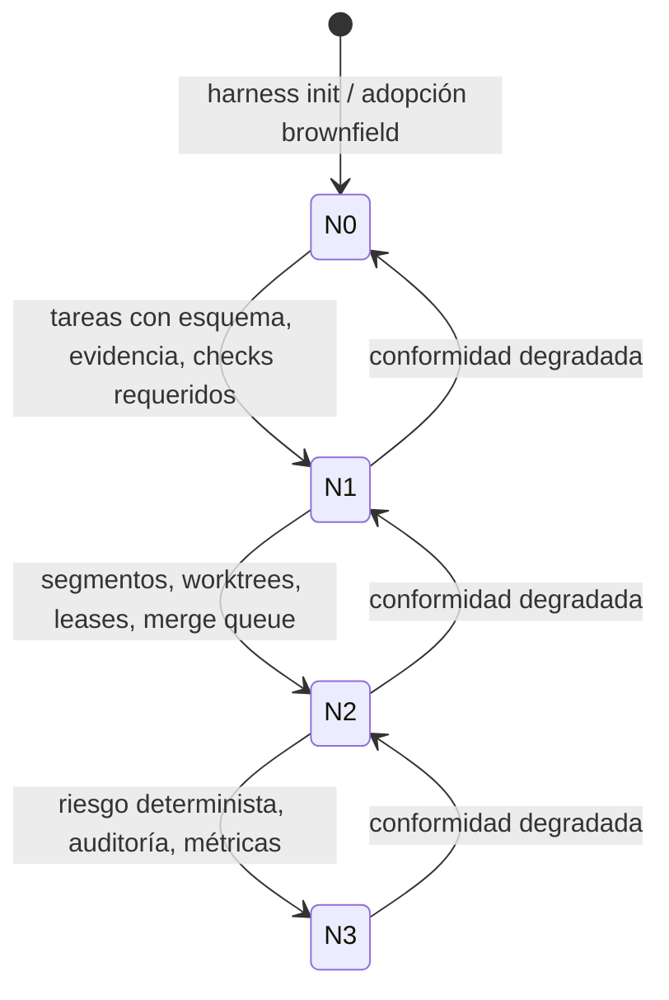
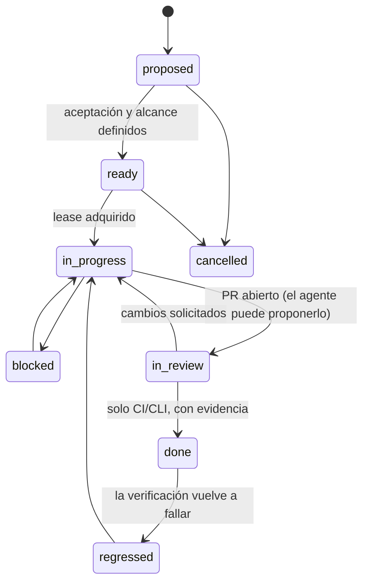

# 01 · Modelo conceptual del harness

Este documento fija el vocabulario estructural sobre el que se apoyan los requisitos. Es una **taxonomía conceptual, no una arquitectura de implementación**. Las rutas y formatos concretos se definen en las fichas de archivo (Fase 2) y en los adaptadores (Fases 3 y 5).

## 1. Principios rectores

| ID | Principio | Fundamento |
|---|---|---|
| PR-1 | **El repositorio es el sistema de registro.** El conocimiento que el trabajo necesita y no está versionado en el repositorio no existe a efectos del harness. | S-OAI-HE p.7; S-LHE L03 |
| PR-2 | **Primero el índice, el detalle bajo demanda.** Las instrucciones raíz son un mapa; el detalle vive en documentos enlazados, skills o instrucciones locales. | S-OAI-HE p.5; S-CC-MEM; S-SKILLS |
| PR-3 | **Las instrucciones guían y los controles imponen.** Ninguna obligación crítica depende solo de lenguaje natural. | S-CC-MEM; S-VILA p.20; ADR-009 |
| PR-4 | **El agente no certifica su propio trabajo.** "Hecho" lo determina una verificación externa y determinista con evidencia enlazada. | S-LHE L08–L09; Anthropic *Effective harnesses* (sección "Testing"); ADR-005 |
| PR-5 | **Un agente, una tarea, un espacio aislado.** Ningún espacio de trabajo es editado a la vez por dos actores sin un mecanismo explícito de exclusión. | S-OAI-HE p.3; S-GIT; ADR-011 (propuesto) |
| PR-6 | **Mínimo privilegio y reversibilidad por defecto.** | S-VILA Tabla 1 p.4; S-CC-SET |
| PR-7 | **Toda entrada externa es no confiable** hasta que una persona autorizada la revisa. Esto incluye la configuración de agentes que llega en un PR. | S-MCP; S-VILA p.29; ADR-013 |
| PR-8 | **Cada mecanismo es una hipótesis con coste.** Tiene propietario, métrica y condición de retirada, y se revisa cuando cambian los modelos. | Anthropic *Harness design for long-running apps* (sección sobre simplificación); ADR-015 (propuesto) |

## 2. Subsistemas

El modelo parte de los cinco subsistemas de S-LHE L02 y del marco del proyecto. Cada subsistema se traduce en dominios de requisitos y en roles de archivo.

| Subsistema | Pregunta que responde | Dominios | Artefactos principales (roles) | Capa de control dominante |
|---|---|---|---|---|
| **Instrucciones** | ¿Qué es esto, qué reglas hay y dónde está el detalle? | INS, CTX | `instructions.root` (AGENTS.md), instrucciones locales, `adapter.claude.instructions` (CLAUDE.md), skills | L1 |
| **Herramientas** | ¿Qué puede hacer el agente y con qué permisos? | CMP, SEC | Configuración del agente (`.claude/settings.json`), catálogo de componentes, MCP | L2, L3 |
| **Entorno** | ¿Cómo se prepara, ejecuta y aísla el trabajo? | VER, CON | Contrato de comandos, worktrees, entorno reproducible | L3, L4 |
| **Estado** | ¿Dónde estamos, qué se decidió y qué falta? | STA, ARC | Tareas y planes, ADR del proyecto, mapa de arquitectura y segmentos | L1, L4 (transiciones) |
| **Retroalimentación** | ¿Cómo se sabe que algo está bien y quién lo autoriza? | VER, CI, OBS, GOV | Checks de CI, rulesets, CODEOWNERS, evidencias, métricas | L4, L5 |

Hay un sexto aspecto **transversal**, el **gobierno** (GOV): manifiesto, nivel de conformidad, waivers y versión del estándar. No es un subsistema del agente, sino del uso organizativo del harness.

## 3. Conocimiento estable frente a estado de tarea

| | Conocimiento estable | Estado de tarea |
|---|---|---|
| **Ejemplos** | Arquitectura, segmentos, ADR del proyecto, seguridad, convenciones, comandos | Plan, progreso, decisiones locales, evidencias, *lease* |
| **Cambia** | Con baja frecuencia y por PR revisado | En cada sesión |
| **Ubicación** | `AGENTS.md`, `docs/architecture/`, `docs/decisions/`, `docs/security/` | Un archivo por tarea (ADR-005) |
| **Se carga** | Índice siempre; detalle bajo demanda | Solo el de la tarea en curso |
| **Riesgo si se mezclan** | Instrucciones infladas con estado obsoleto | Pérdida de continuidad entre sesiones |

**(Normativo)** El estado de una tarea NO DEBE escribirse en los archivos de instrucciones (HS-INS-004).

## 4. Ciclos de vida

### 4.1 Instancia

### 4.2 Tarea (ADR-005; el esquema detallado se define en la Fase 2)

### 4.3 Sesión de trabajo (informativo; el workflow se especifica en las Fases 2 y 5)

Adapta la rutina de inicio y cierre de Anthropic *Effective harnesses for long-running agents* (sección "Getting up to speed") a un contexto de equipo.

1. **Entrada.**
   - Confirmar el espacio de trabajo: worktree y rama de la tarea.
   - Leer el índice de instrucciones y el archivo de la tarea.
   - Ejecutar `setup` si hace falta y `check`, para confirmar que el punto de partida está sano antes de cambiar nada.
2. **Trabajo.**
   - Una tarea activa por agente.
   - Cambios dentro del alcance y de los segmentos declarados.
   - Ejecutar `check` tras cada cambio significativo.
3. **Salida.**
   - Registrar el progreso y las decisiones en el archivo de la tarea.
   - Dejar el árbol limpio y con commit.
   - Abrir o actualizar el PR.
   - La transición a `done` no la hace el agente.

### 4.4 Inicialización

La primera sesión de un proyecto, o la de su adopción, es una fase propia y produce infraestructura, no funcionalidades. Así lo plantean Anthropic *Effective harnesses* (agente inicializador) y S-LHE L06. En este estándar, el resultado de esa fase es una instancia N0 conforme, creada con `harness init` (Fase 7) o adoptada a mano.

## 5. Capas de control (normativo, ADR-009)

| Capa | Mecanismo | Determinista | Verificable desde el servidor | Autoridad final |
|---|---|---|---|---|
| **L1** Instrucciones | AGENTS.md, skills, reglas por ruta | No | No | No |
| **L2** Permisos del agente | Reglas deny → ask → allow y sandbox | Sí (con límites documentados) | No | No |
| **L3** Hooks locales | Hooks de tipo `command` | Sí | No | No |
| **L4** CI | Checks de GitHub Actions requeridos | Sí | Sí | **Sí** |
| **L5** Plataforma | Rulesets, CODEOWNERS, merge queue, environments | Sí | Sí | **Sí** |

Reglas normativas:

- Todo requisito con `naturaleza: enforcement` DEBE estar respaldado por al menos un control L4 o L5 (HS-GOV-005).
- Los hooks de tipo `prompt` o `agent` NO DEBEN contarse como control.
- Cuando exista un control L3 que bloquee una acción, la CI DEBERÍA ejecutar la misma comprobación (paridad).

## 6. Responsabilidades

| Actividad | Persona responsable | Agente | Sistemas automatizados (CLI, CI, plataforma) |
|---|---|---|---|
| Definir el alcance y la aceptación de una tarea | **Responde**; puede delegar la redacción | Propone | Valida el esquema |
| Implementar | Supervisa según nivel y riesgo | **Ejecuta** | Proporciona feedback (`check`) |
| Declarar "hecho" | — | **No puede** | **Decide** con evidencia |
| Revisar | **Aprueba** según CODEOWNERS y ruleset | Revisión informativa | Exige los aprobadores |
| Fusionar y desplegar | Autoriza según riesgo (Fase 5) | No autoriza | **Impone** las condiciones |
| Cambiar la configuración de agentes | Propietario de plataforma o seguridad aprueba | Puede proponer | CODEOWNERS lo exige |
| Declarar nivel y waivers | Propietario de instancia | — | La CLI comprueba la validez y la caducidad |

## 7. Modelo de confianza (resumen; se desarrolla en la Fase 5)

- **Fronteras de confianza:**
  - rama principal protegida ↔ rama de PR;
  - repositorio ↔ fuentes externas (issues, web, MCP);
  - máquina local ↔ runner de CI;
  - job con credenciales del modelo ↔ job con permisos de escritura.
- **La configuración de agentes que llega en un PR es una entrada no confiable** hasta que se fusiona con la aprobación de CODEOWNERS (ADR-013).
- **En CI, los agentes no cargan la configuración del PR:** se ejecutan en modo `--bare` con configuración explícita (ADR-013; S-CC-SET, headless).
